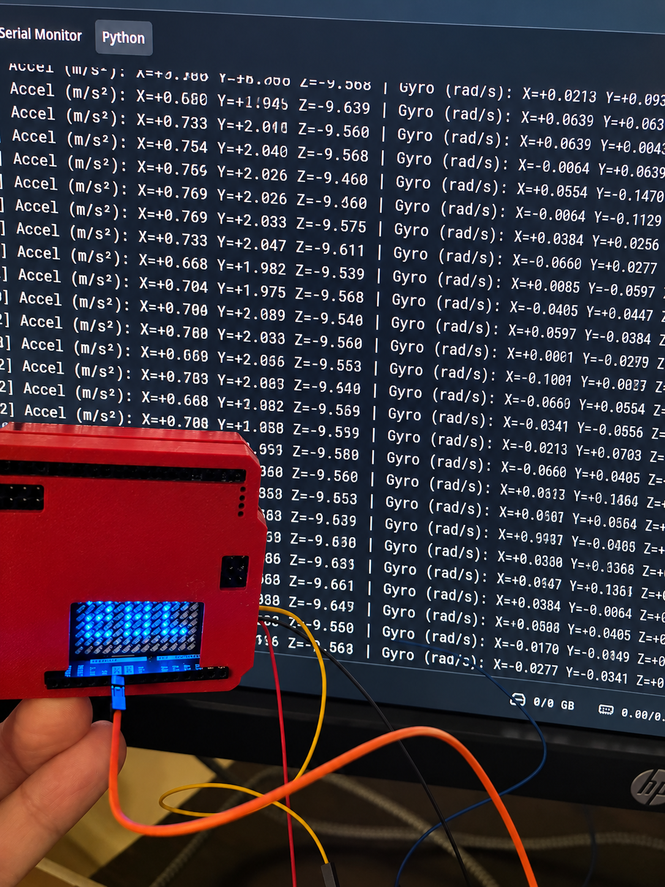
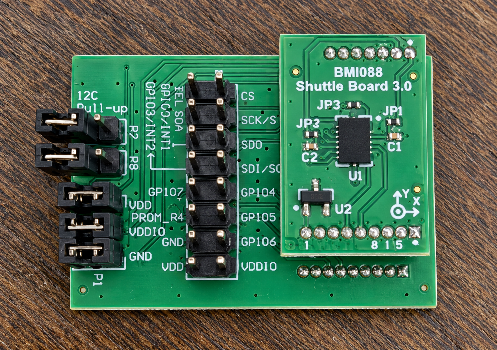
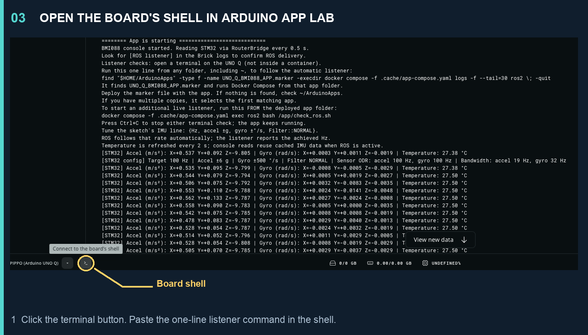
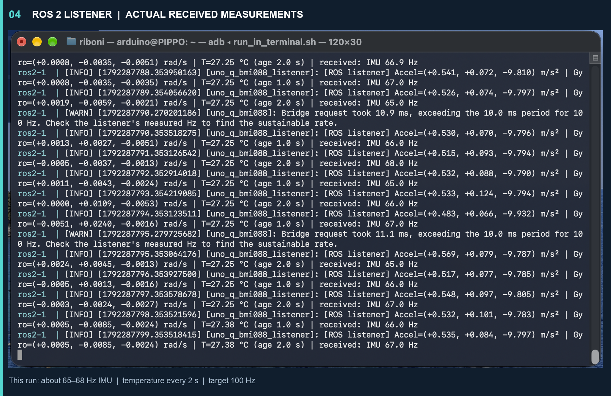
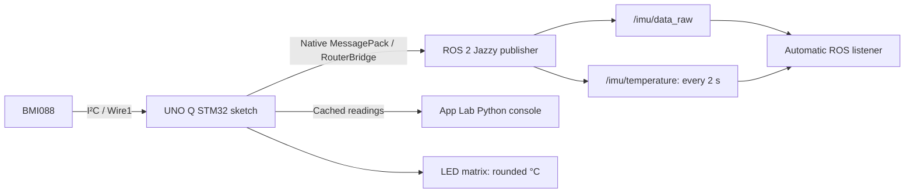

# Bosch Sensortec sensors on Arduino UNO Q with ROS 2 Jazzy

**BMI088 IMU: working. BMP581 pressure sensor: planned.**

This is my personal experiment in bringing Bosch Sensortec sensors into ROS 2 using the Arduino UNO Q and Arduino App Lab. The STM32 reads the sensor, RouterBridge carries the measurements to Linux, and a custom ROS 2 Jazzy Brick publishes standard messages. A Python console and an automatic ROS listener make the whole path visible.

The goal is a project that another hobbyist can understand, reproduce and extend: one line to tune the IMU, readable measurements in the console, temperature on the board's LED matrix, and fewer surprises when deploying changes to a custom Brick.

> **Personal-project disclaimer:** This is my independent hobby project, developed in a personal capacity. It is not affiliated with, endorsed by, sponsored by or an official project of Bosch Sensortec. The code, documentation and results are my own experiments, not an official Bosch Sensortec integration or support offering. Product names identify the hardware used.

<p align="center">
  <a href="docs/images/uno-q-bmi088-project-preview-enhanced.png">
    
  </a>
</p>

*AI-enhanced preview of my Arduino UNO Q prototype. [Original photo](docs/images/originals/project-preview-original.jpeg). For actual measurements and delivery rates, see the unaltered ROS log screenshot below.*

**Which sensor would you like to see next?** [Open a sensor request](https://github.com/mauringo/bosch-sensortec-ros2-unoq/issues/new?template=sensor-request.yml) with the sensor name, module link and what you want to build. BMI088 works today; BMP581 is the next planned addition. Suggestions and reports from other Arduino UNO Q setups are welcome.

## What works now, and what comes next

| Sensor / feature | Status | What this repository provides |
| --- | --- | --- |
| **Bosch Sensortec BMI088** | **Working on my setup** | Acceleration, angular velocity and sensor die temperature |
| Arduino UNO Q + Arduino App Lab | Working on my setup | STM32 sketch, Python console and custom ROS 2 Jazzy Brick |
| ROS IMU delivery | Observed in the supplied logs | Approximately **65–68 Hz** in the shown run, with a 100 Hz target |
| Temperature | Working | Celsius, published once every **2 seconds**, also shown on the matrix |
| **Bosch Sensortec BMP581** | **Future support** | Planned pressure and temperature integration; no BMP581 driver or ROS pressure publisher is implemented yet |

The screenshot is a short observation from one hobby setup, not a guarantee of sustained throughput or a hardware maximum. Earlier JSON-based logs showed roughly 32–33 Hz; the later compact-Bridge run shown here is faster, but these were not controlled benchmark runs.

## My hardware: functional, a little messy

I did not have a fancy ready-to-use sensor module, so I used what I had: a **BMI088 Shuttle Board 3.0 on an adapter board**, connected as a prototype. Yes, the setup is a bit of a wiring mess. It is enough to explore the software path, and it is the hardware behind these results.

<p align="center">
  <a href="docs/images/bmi088-shuttle-board-adapter-enhanced.png">
    
  </a>
</p>

*AI-enhanced overview of my adapter and BMI088 shuttle board. [Original photo](docs/images/originals/bmi088-adapter-original.png). Use the original and the module documentation for pin labels and wiring; enhanced lettering may differ.*

For a tidier build, look for a suitable **3.3 V I²C breakout with Qwiic connectors**, such as modules from 7Semi, SparkFun or other suppliers. Choose the exact sensor first: a matching connector does not make different Bosch sensors interchangeable.

| Module example | Why it is relevant | Support in this repository |
| --- | --- | --- |
| [7Semi BMP581 breakout](https://7semi.com/bmp581-barometric-pressure-altitude-sensor-breakout/) | A BMP581 board with Qwiic connectivity for a cleaner pressure-sensor setup | **Planned**, not tested with this app |
| [SparkFun BMP581 Qwiic pressure sensor](https://www.sparkfun.com/sparkfun-pressure-sensor-bmp581-qwiic.html) | Another Qwiic BMP581 option for the future pressure-sensor work | **Planned**, not tested with this app |
| [7Semi BMI270 Nano Qwiic IMU](https://7semi.com/bmi270-nano-6-axis-imu-sensor-board-qwiic/) | An example of the compact Qwiic IMU format I would prefer over loose wiring | **Different sensor; not supported by the BMI088 driver** |

These links are examples to explore, not endorsements or claims of compatibility testing. For the current working app, use a **BMI088** board with suitable I²C connections. BMI270, BMI323 and BMP581 need their own sensor drivers.

### Connections used by this app

Arduino's [UNO Q manual](https://docs.arduino.cc/tutorials/uno-q/user-manual/) identifies the Qwiic bus as `Wire1` and specifies **3.3 V** Qwiic operation.

| Connection / setting | This project |
| --- | --- |
| I²C bus | Qwiic connector, `Wire1` |
| Bus clock | 400 kHz |
| BMI088 accelerometer address | `0x18` |
| BMI088 gyroscope address | `0x68` |
| Sensor library | Bolder Flight Systems BMI088 **1.0.1**, unchanged |
| Physical quantities | Acceleration in m/s², angular velocity in rad/s, temperature in °C |

Connect the corresponding 3.3 V supply, ground, SDA and SCL signals using your module's documentation. Check its I²C/SPI selection, address jumpers and pull-ups. If its addresses differ, edit `BMI088_ACCEL_ADDR` and `BMI088_GYRO_ADDR` in [the sketch](sketch/sketch.ino). The pictured adapter is not a universal pinout guide.

## Run it in Arduino App Lab

1. Download or clone this repository and create/open an app for your connected **Arduino UNO Q** in App Lab.
2. Put the whole project in that app's directory, including `app.yaml`, `sketch/`, `python/`, `bricks/` and `UNO_Q_BMI088_APP.marker`. Keep the folder layout intact.
3. Connect the BMI088 to the Qwiic I²C bus. The sketch uses `Wire1`, not the UNO-style header bus `Wire`.
4. In [`sketch/sketch.ino`](sketch/sketch.ino), choose the one-line IMU configuration below.
5. **Deploy/Run** the app. For an existing installation, Stop first and then Deploy/Run so App Lab applies the current Brick configuration.
6. Select the **Python** output tab to read the lines printed by [`python/main.py`](python/main.py).
7. Open the board's Linux shell using the bottom-left terminal button shown below, then paste the listener command.
8. Check that the ROS logs say `Compact IMU transport enabled; temperature publishes every 2 s`.

The first ROS image build/download needs free storage on the UNO Q. The stale-container workaround described later assumes the container can already start.

### Where to open the console and enter the command

<p align="center">
  <a href="docs/images/app-lab-open-board-shell.png">
    
  </a>
</p>

*The main pane is Python application output. The highlighted terminal button opens the board's Linux shell, where you enter Docker commands. Reading Python output and opening a shell are separate actions.*

Once the shell is open, paste this **one line**. It works from `~` or any other folder:

```bash
find "$HOME/ArduinoApps" -type f -name UNO_Q_BMI088_APP.marker -execdir docker compose -f .cache/app-compose.yaml logs -f --tail=30 ros2 \; -quit
```

It finds this app's marker, runs Compose from the correct app folder and follows the already-running ROS publisher/listener logs. If there are multiple copies, it uses the first match. If nothing is found, check that the marker was deployed under `~/ArduinoApps`.

**Why not just run Compose from `~`?** The relative path `.cache/app-compose.yaml` belongs to the deployed app folder. From the home directory it points to a different, usually missing file. The marker command handles that working-directory detail for you.

To start an additional listener, run this **from the deployed app directory**:

```bash
docker compose -f .cache/app-compose.yaml exec ros2 bash /app/check_ros.sh
```

Press Ctrl+C to stop following logs or stop the extra listener. The application and its automatic listener keep running.

## Tune the BMI088 with one line

Edit this near the top of [`sketch/sketch.ino`](sketch/sketch.ino), then Deploy:

```cpp
constexpr ImuSettings IMU = {100, 6, 500, Filter::NORMAL};
//                          Hz   ±g  ±°/s  filtering
```

| Setting | Choices |
| --- | --- |
| Requested IMU / ROS rate | Integer **1–1600 Hz**; achievable rate depends on the whole system |
| Accelerometer range | ±3, ±6, ±12, ±24 g |
| Gyroscope range | ±125, ±250, ±500, ±1000, ±2000 °/s |
| Filter profile | `Filter::WIDE`, `Filter::NORMAL`, `Filter::SMOOTH` |

For example, `{200, 12, 1000, Filter::WIDE}` requests 200 Hz and wider motion ranges. The sketch picks supported sensor output rates and bandwidths; Python prints those effective settings, and ROS follows the requested rate automatically.

Start with the default and watch **received IMU Hz**, rather than assuming that raising the target increases throughput. Smaller ranges give more resolution when the motion does not clip. Wider filtering passes more rapid motion and more noise. The available gyro bandwidths depend on its output rate, so some filter profiles map to the same hardware setting. See the [technical guide](docs/technical-guide.md#tune-everything-with-one-sketch-line) for the detailed mapping and limitations.

## What the working result looks like

<p align="center">
  <a href="docs/images/ros2-bmi088-listener-results.png">
    
  </a>
</p>

*Actual supplied output: roughly 65–68 Hz received IMU data, temperature around 27 °C and a 100 Hz target. The warnings are retained: they show where the requested timing is tighter than a measured Bridge request.*

A listener line tells you:

- **Accel:** X/Y/Z acceleration in m/s². Gravity is present; approximately −9.8 on Z is consistent with the orientation shown in these logs.
- **Gyro:** X/Y/Z angular velocity in rad/s.
- **T:** BMI088 sensor die temperature in **degrees Celsius**, not a calibrated ambient thermometer.
- **Age:** time since the last ROS temperature message arrived. Temperature is intentionally sent every two seconds; the STM32 cache can already be up to two seconds old before that message arrives.
- **Received IMU Hz:** messages actually received by this subscriber. It is not the sensor's advertised hardware rate.
- **Bridge warning:** an RPC took longer than the period requested by the configuration. It is a timing limit to investigate, not a temperature error.

## What the code does, from start to finish



1. **Configure and initialize.** The sketch starts I²C and the unchanged BMI088 library, applies your ranges/filter profile and retries initialization if the sensor is unavailable.
2. **Read the sensor.** A fast IMU request calls the library's accelerometer and gyro readers. The library supplies m/s² and rad/s with its existing axis conventions.
3. **Cross the Bridge efficiently.** `read_imu_fast` returns eight numeric values: readiness, target rate and six measurements. MessagePack carries the array directly, avoiding a JSON string and float-to-text conversion on every sample.
4. **Publish ROS messages.** `ros_sensor.py` validates those measurements, follows the sketch's rate and publishes `sensor_msgs/Imu` on `/imu/data_raw`. It reuses message objects to reduce repeated allocations.
5. **Handle slow temperature separately.** A separate timer requests the cached temperature and publishes `sensor_msgs/Temperature` on `/imu/temperature` every two seconds. The console and matrix use the same slow cache. The unchanged library still reads temperature internally during its normal accelerometer read.
6. **Show the values.** `main.py` prints cached measurements twice per second. The matrix shows rounded Celsius values, such as `27C`, without a blocking text animation.
7. **Verify delivery.** `ros_listener.py` is a separate process that subscribes to both ROS topics. It reports the received IMU rate and the latest temperature's age; it does not make extra Bridge calls.
8. **Recover and reload.** `run.py` starts the publisher/listener together, restarts them after a process failure and reloads deployed Python source. Docker provides container-level recovery.

The result is a **working BMI088-to-ROS data path with visible diagnostics**. It is not yet an orientation estimator, calibrated navigation stack or BMP581 pressure driver. Orientation is marked unavailable in the IMU message; timestamps use Linux receipt time, not sensor acquisition time.

## The stale custom-Brick container problem—and the workaround

### What went wrong

The original Dockerfile copied the Brick's Python files into the image. On this setup, deploying edited local Brick code could leave the existing container/image running the old files. Restarting that container did not replace the code baked into its image.

The workaround changes how this project loads its source. It does **not** patch Arduino App Lab or claim to fix the upstream deployment behavior.

### The tricks used here

| Change | What it solves | Where to look |
| --- | --- | --- |
| Read-only `./app:/app:ro` bind mount | The ROS container reads the deployed Brick source instead of relying only on the old image copy | [Brick Compose](bricks/ros2_jazzy/brick_compose.yaml) |
| Explicit Compose command for `/app/run.py` | Uses the current startup script even if an older cached image has a different default command | [Brick Compose](bricks/ros2_jazzy/brick_compose.yaml) |
| Small source-reload supervisor | Hashes Python files every 0.5 s, allows a 1 s upload settling period, then restarts both ROS processes when source changes | [`run.py`](bricks/ros2_jazzy/app/run.py) |
| Source revision in logs | Lets you see that deployed Python content changed | `[ROS runtime] Source revision ...` |
| `restart: unless-stopped` | Restarts a failed container; this is recovery, not a source update mechanism | [Brick Compose](bricks/ros2_jazzy/brick_compose.yaml) |
| No reliance on Compose Watch for Python edits | Ordinary App Lab Deploy may not launch `docker compose watch`; the running supervisor checks its mounted source itself | [Technical guide](docs/technical-guide.md#fixing-the-stale-container-after-deploy) |

### What still requires what

| What you edit | Required action |
| --- | --- |
| `sketch/sketch.ino` | Deploy/flash the sketch so the STM32 runs the new configuration/code |
| `python/main.py` | Deploy/restart the normal App Lab Python app |
| Python under `bricks/ros2_jazzy/app/` | Deploy the files; once the mount is installed, the supervisor reloads changed Python source |
| Brick mounts, environment or startup command | Stop and Deploy/Run so App Lab recreates/applies the container configuration |
| Dockerfile, requirements or base image | Rebuild the ROS image; mounted source does not install dependencies |

**One-time setup matters:** an already-running old container cannot add a new mount or startup command to itself. Stop the app and Deploy/Run once to install this configuration. Afterward, ordinary Brick Python edits should no longer need the manual rebuild workaround. Behavior still depends on the installed App Lab version and how files are deployed.

If App Lab still leaves the old container in place, run the original fallback **from the app directory on the UNO Q**:

```bash
docker compose -f .cache/app-compose.yaml up -d --build --force-recreate ros2
```

This rebuilds/recreates only the `ros2` service. Keep it for the initial transition or actual dependency/image changes, rather than treating it as part of every Python edit.

A Docker image extraction error saying `no space left on device` is a separate host-storage problem. Neither `main.py` nor a Python process inside a container can repair an image that failed to build or start.

## Find your way around the repository

| File | Role |
| --- | --- |
| [`sketch/sketch.ino`](sketch/sketch.ino) | One-line configuration, BMI088 reads, Bridge endpoints, matrix and initialization retry |
| [`python/main.py`](python/main.py) | Human-readable console, active configuration and the one-line listener command |
| [`ros_sensor.py`](bricks/ros2_jazzy/app/ros_sensor.py) | Compact transport, standard ROS messages and the separate temperature timer |
| [`ros_listener.py`](bricks/ros2_jazzy/app/ros_listener.py) | Independent subscriber that shows values, received Hz and temperature age |
| [`run.py`](bricks/ros2_jazzy/app/run.py) | Parallel process startup, crash recovery and source reload |
| [`bridge.py`](bricks/ros2_jazzy/app/app_utils/bridge.py) | Persistent MessagePack RPC socket, bounded waits and reconnect-on-failure |
| [`brick_compose.yaml`](bricks/ros2_jazzy/brick_compose.yaml) | Container build, source/socket mounts, ROS environment and restart policy |
| [Technical guide](docs/technical-guide.md) | Protocol, ROS metadata, tuning, manual diagnostics and deployment details |
| [Image notes](docs/images/README.md) | Figure descriptions, editing notes and original-photo links |
| [Tests](tests/test_runtime.py) | Simulated Bridge, message conversion, temperature timing and reload checks |

## Roadmap and sensor requests

- **Working now:** BMI088 acceleration, angular velocity and die temperature on Arduino UNO Q, with ROS 2 Jazzy output.
- **Next planned sensor:** **Bosch Sensortec BMP581**, for barometric pressure and temperature. Support will be added in a future update; it is not present in this release and no delivery date is promised.
- **Further experiments:** Bridge throughput, buffered sampling, acquisition timestamps, calibration and diagnostics.

**What would you like connected next?** [Request a sensor](https://github.com/mauringo/bosch-sensortec-ros2-unoq/issues/new?template=sensor-request.yml), share the board/module you have, and describe the ROS data you need. If you can test the hardware, say so—that helps turn an idea into a reproducible example.

## References and acknowledgements

This project builds on my [basic ROS 2 Jazzy on Arduino UNO Q example](https://github.com/mauringo/ROS-2-Jazzy-on-Arduino-UNO-Q-Basic). It uses Arduino RouterBridge, ROS 2 and the [Bolder Flight BMI088 library](https://github.com/bolderflight/bmi088-arduino/tree/v1.0.1).

For the hardware itself, use the primary references: [Arduino UNO Q manual](https://docs.arduino.cc/tutorials/uno-q/user-manual/), [Bosch Sensortec BMI088](https://www.bosch-sensortec.com/en/products/motion-sensors/imus/bmi088), and [Bosch Sensortec BMP581](https://www.bosch-sensortec.com/en/products/environmental-sensors/pressure-sensors/bmp581). Their documentation describes the products; this hobby repository describes my integration.
