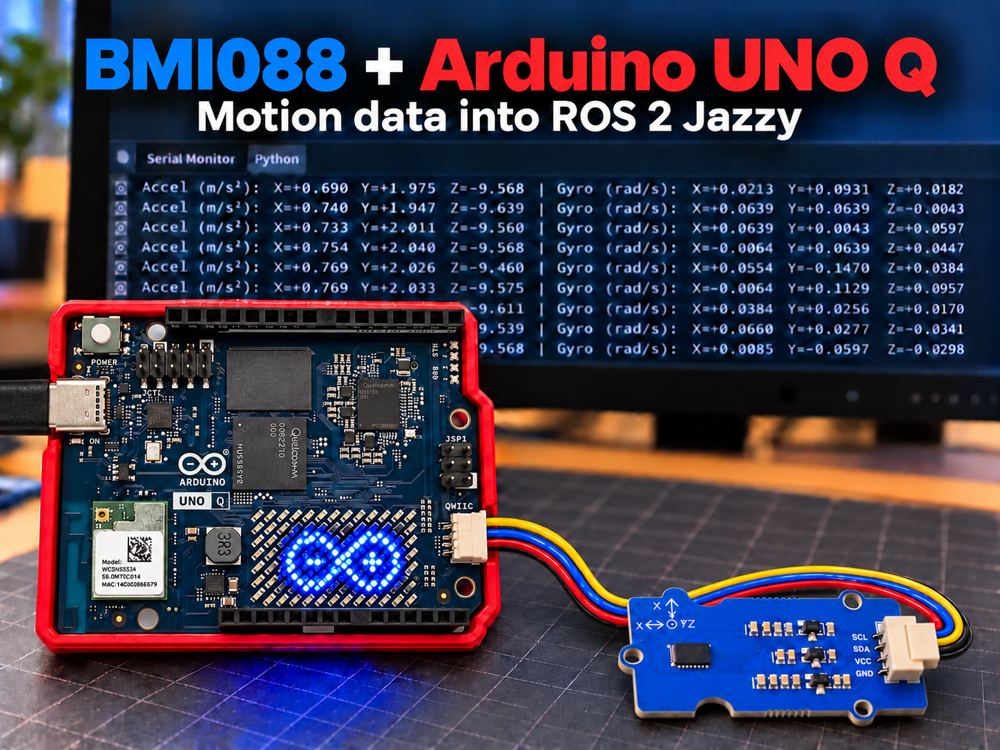
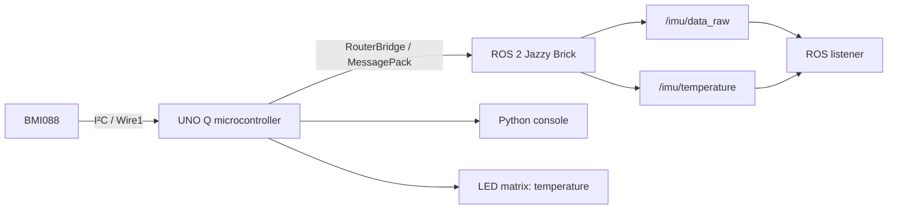

# Bosch Sensortec BMI088 on Arduino UNO Q with ROS 2 Jazzy

**Bring high-quality sensing to Arduino UNO Q with Bosch Sensortec sensors—starting with BMI088 motion and temperature data in ROS 2 Jazzy.**

<p align="center">
  
</p>

*AI-generated cover based on hardware references. The Grove module, wiring colors, screen data and Arduino LED symbol are illustrative. The tested build uses a shuttle board and adapter; the sketch displays temperature. Use the [wiring guide](docs/hardware.md), not the cover, to connect your hardware.*



The microcontroller reads the BMI088 over I²C. RouterBridge carries the measurements to the ROS 2 Brick, while the Python console, LED matrix and ROS listener make the data visible.

[Get started](#run-it-in-arduino-app-lab) · [Wiring](docs/hardware.md) · [Technical guide](docs/technical-guide.md) · [Roadmap](docs/roadmap.md) · [Report an issue](https://github.com/mauringo/bosch-sensortec-ros2-unoq/issues)

This personal project connects a **Bosch Sensortec BMI088** to the UNO Q's microcontroller over I²C. **RouterBridge** carries the measurements to Linux, where a custom **Arduino App Lab Brick** publishes standard ROS 2 Jazzy messages. A Python console, LED matrix and automatic ROS listener help you see the whole path working.

> **Independent personal project:** Not affiliated with, sponsored by, endorsed by or an official project of Arduino or Bosch Sensortec. Product names identify the hardware used.

## What you get

| Feature | What to expect |
| --- | --- |
| Motion data | Acceleration in m/s² and angular velocity in rad/s on `/imu/data_raw` |
| Temperature | Sensor die temperature in °C on `/imu/temperature`, every two seconds |
| Visible feedback | Python console, rounded temperature on the LED matrix and a ROS listener showing received rates |
| Simple tuning | One sketch line for target rate, measurement ranges and filtering |
| Working example | Approximately **65–68 Hz received** in the supplied run, with a **100 Hz target** |

BMI088 is the working sensor. BMP581 is [planned](docs/roadmap.md#planned-bmp581). The recorded rate is an observation from one setup, not a sustained-rate guarantee. Orientation estimation and calibration are future work.

## Before you start

- **Arduino UNO Q**, connected to Arduino App Lab, with a suitable USB connection.
- **BMI088 board with I²C enabled**, plus wiring or an adapter matching its connector.
- **3.3 V Qwiic connections:** supply, ground, SDA and SCL. A Grove module needs suitable Grove-to-Qwiic wiring; connector shape and wire color alone do not establish the pinout.
- Enough free storage on the UNO Q for the first ROS container build/download.

The demonstrated setup uses a **BMI088 Shuttle Board 3.0 and an adapter**. See the [hardware guide](docs/hardware.md) for photos, alternative modules and address settings.

### Arduino UNO Q to BMI088 pinout and I²C connections

| Setting | Default in this project |
| --- | --- |
| I²C bus | Qwiic, **`Wire1`**, at 400 kHz |
| Supply / logic | **3.3 V** Qwiic connections |
| Accelerometer address | `0x18` |
| Gyroscope address | `0x68` |
| Sensor library | [Bolder Flight Systems BMI088 1.0.1](https://github.com/bolderflight/bmi088-arduino/tree/v1.0.1), pinned in [`sketch.yaml`](sketch/sketch.yaml) |

Connect matching **3.3 V, GND, SDA and SCL** signals using your module's documentation. Check interface-selection jumpers and pull-ups. If your module uses different addresses, change `BMI088_ACCEL_ADDR` and `BMI088_GYRO_ADDR` in [the sketch](sketch/sketch.ino). The [Grove example](docs/hardware.md#online-examples-of-bmi088-modules) documents different default addresses.

## Run it in Arduino App Lab

### 1. Open the app

Download the [repository ZIP](https://github.com/mauringo/bosch-sensortec-ros2-unoq/archive/refs/heads/main.zip), or clone it:

```bash
git clone https://github.com/mauringo/bosch-sensortec-ros2-unoq.git
```

Create/open an app for your connected UNO Q in App Lab and put the project contents in its app directory. Keep these together:

```text
app.yaml
UNO_Q_BMI088_APP.marker
sketch/
python/
bricks/
```

### 2. Connect and deploy

Connect your BMI088 using the [wiring settings above](#arduino-uno-q-to-bmi088-pinout-and-i²c-connections). Start with the default configuration in [`sketch/sketch.ino`](sketch/sketch.ino), then **Deploy/Run**.

For an existing installation, **Stop**, then **Deploy/Run** once so App Lab applies the current Brick mounts and startup command.

### 3. See the measurements

Select App Lab's **Python** output tab to read the console. Open the UNO Q's **Linux shell** using the bottom-left terminal button:

<details>
<summary>Show where to open the board shell</summary>


The Python pane displays application output. Enter the following Docker command in the board shell.

</details>

Paste this single line into the **UNO Q board shell**, from any directory:

```bash
find "$HOME/ArduinoApps" -type f -name UNO_Q_BMI088_APP.marker -execdir docker compose -f .cache/app-compose.yaml logs -f --tail=30 ros2 \; -quit
```

It locates the deployed app and follows its ROS logs. With multiple copies, it selects the first match. Press **Ctrl+C** to stop following logs; the app keeps running.

**Success looks like:**

- Python prints acceleration, angular velocity and temperature.
- The matrix shows rounded sensor temperature, for example `27C`.
- ROS logs include `Compact IMU transport enabled; temperature publishes every 2 s`.
- `[ROS listener]` lines show incoming data and **received IMU Hz**.

## Tune the BMI088 with one line

Edit this near the top of [the sketch](sketch/sketch.ino), then Deploy:

```cpp
constexpr ImuSettings IMU = {100, 6, 500, Filter::NORMAL};
//                          Hz   ±g  ±°/s  filtering
```

| Setting | Choices |
| --- | --- |
| Requested IMU / ROS rate | Integer **1–1600 Hz**; actual delivery depends on the system |
| Accelerometer range | ±3, ±6, ±12, ±24 g |
| Gyroscope range | ±125, ±250, ±500, ±1000, ±2000 °/s |
| Filter | `Filter::WIDE`, `Filter::NORMAL`, `Filter::SMOOTH` |

Start with the defaults and watch the listener's **received** rate. Raising the target does not guarantee higher throughput. See [configuration details](docs/technical-guide.md#tune-everything-with-one-sketch-line) for hardware rates, filtering and limitations.

## What the working result looks like


*Actual supplied output, separate from the generated cover: roughly 65–68 Hz IMU delivery and sensor temperature around 27 °C. Bridge timing warnings are retained.*

| Listener field | Meaning |
| --- | --- |
| Accel / Gyro | Three-axis acceleration in m/s², including gravity, and angular velocity in rad/s |
| T | Sensor die temperature, not a calibrated ambient thermometer |
| Age | Time since the last ROS temperature message arrived; the sensor cache can already be up to two seconds old |
| Received IMU Hz | Messages received by this subscriber, rather than the requested or advertised sensor rate |

## How it fits together


| Topic | Standard ROS message | Rate |
| --- | --- | --- |
| `/imu/data_raw` | `sensor_msgs/msg/Imu` | Follows the sketch target; default 100 Hz |
| `/imu/temperature` | `sensor_msgs/msg/Temperature` | 0.5 Hz |

The project uses RouterBridge, with no micro-ROS client or agent. Orientation is marked unavailable. Timestamps use Linux receipt time, not sensor acquisition time; covariances and calibration limitations are explained in the [technical guide](docs/technical-guide.md#data-flow).

## Need a hand?

| Symptom | Start here |
| --- | --- |
| Sensor unavailable or matrix shows `--` | Check 3.3 V, ground, `Wire1`, I²C selection and both sensor addresses against the [hardware guide](docs/hardware.md). Initialization retries automatically. |
| Python works, but ROS data is missing | Open the ROS logs using the board-shell command above; check the [ROS diagnostics](docs/technical-guide.md#recovery-and-diagnostics). |
| Log command prints nothing | Confirm `UNO_Q_BMI088_APP.marker` was deployed under `~/ArduinoApps`. |
| Compose cannot find `.cache/app-compose.yaml` | Use the marker command above, or run Compose from the deployed app directory. |
| Edited Brick Python still runs old code | Stop, then Deploy/Run to install the source mount. See the [stale-container workaround](docs/technical-guide.md#fixing-the-stale-container-after-deploy). |
| `no space left on device` during the image build | Free storage on the UNO Q, then retry the build. A Python restart cannot repair a failed image build. |
| Received rate is below the target | Start at the default configuration and inspect Bridge timing warnings; the target is not a throughput guarantee. |

For the initial stale-container transition or image/dependency changes, the manual fallback is:

```bash
# Run from the deployed app directory on the UNO Q.
docker compose -f .cache/app-compose.yaml up -d --build --force-recreate ros2
```

Ordinary Brick Python edits reload from mounted source once that setup is installed. Changes to mounts or startup settings need Stop + Deploy/Run; Dockerfile/dependency changes need an image rebuild. [Full deployment details](docs/technical-guide.md#fixing-the-stale-container-after-deploy).

## Explore, contribute and build on it

| You want to… | Go to |
| --- | --- |
| Check wiring or choose a BMI088 module | [Hardware guide](docs/hardware.md) |
| Understand transport, rates, ROS metadata or recovery | [Technical guide](docs/technical-guide.md) |
| Change the sensor configuration | [`sketch/sketch.ino`](sketch/sketch.ino) |
| Change ROS publishing or listening | [`ros_sensor.py`](bricks/ros2_jazzy/app/ros_sensor.py) · [`ros_listener.py`](bricks/ros2_jazzy/app/ros_listener.py) |
| Understand the custom Brick | [Brick README](bricks/ros2_jazzy/README.md) |
| Report results or contribute a fix | [Contributing guide](CONTRIBUTING.md) |
| Suggest the next sensor | [Roadmap](docs/roadmap.md) |
| Share the project | [Community links and post drafts](docs/sharing.md) |
| Check image provenance | [Image notes](docs/images/README.md) |

New to ROS 2 on UNO Q? Start with the [basic demo without external sensors](https://github.com/mauringo/ROS-2-Jazzy-on-Arduino-UNO-Q-Basic).

## References and license

Built with Arduino RouterBridge, ROS 2 and the unchanged [Bolder Flight BMI088 library](https://github.com/bolderflight/bmi088-arduino/tree/v1.0.1). Hardware references: [UNO Q manual](https://docs.arduino.cc/tutorials/uno-q/user-manual/) and [Bosch Sensortec BMI088](https://www.bosch-sensortec.com/en/products/motion-sensors/imus/bmi088).

Code is licensed under [MIT](LICENSE). Third-party libraries and dependencies retain their respective licenses.
